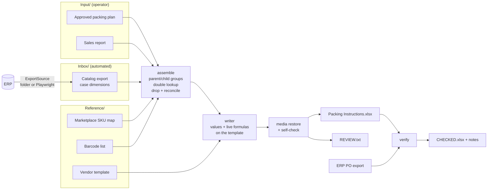

# Vendor Packing Instructions

Turns an approved packing plan into the packing-instructions workbook an overseas vendor packs, labels and invoices from, then double-checks it against the ERP purchase order before it goes out.


[](https://github.com/cristianbarreto08/vendor-packing-instructions/actions/workflows/ci.yml)


## The problem

When a brand sells on Amazon FBA, each overseas purchase order needs a packing-instructions workbook. It tells the factory how many pieces go in each bag, how many bags go in each carton, which marketplace SKU and barcode go on each label, how big the cartons are, and what goes on the commercial invoice. Building it by hand meant chaining lookups across four other workbooks and fixing broken formulas row by row. The file that reached the vendor often had `#REF!` errors, stale cached values, SKUs left over from the last order, or carton sizes in the wrong unit. Mistakes there show up weeks later as mislabeled inventory at the fulfillment center, freight quotes based on the wrong volume, or invoices that don't match the PO.

## What it does

- Reads the vendor tab of the approved packing plan (parent product rows with child pack-size rows) and builds the vendor template's three working tabs: **Box Information**, **Product Labels** and **Packing List & Invoice Info**.
- Translates internal SKUs into what the vendor needs with a **double lookup**: internal child SKU → marketplace (FBA) SKU → barcode and label description. If a pack has no marketplace SKU, it looks the barcode up by internal SKU instead. If there's still no barcode, the pack is marked **`DO NOT PRINT LABEL`**.
- Keeps the in-sheet math as **live formulas**: invoice totals (`SUMIF`), PCS/CASE, # of bags, # of cases, CBM, gross weight and measurement. When someone corrects a quantity, or the vendor types in carton weights, everything downstream recalculates.
- Writes case dimensions **only when the ERP marks them "Confirmed"**, pulls each product's **priority** from the sales report, and **parses the PO number from the filename**.
- Highlights gaps in the workbook (**red** = blocks labeling, **amber** = missing data) and writes a **REVIEW.txt** that lists every excluded or incomplete row, the rule behind it, and where to fix it.
- Re-opens the saved file and **checks it**: no cross-workbook formulas, header row intact, no leftover template rows, totals match the plan, PO # on every row, sample images present byte-for-byte.
- **`verify`** compares a finished (possibly hand-edited) workbook against the ERP PO export. It checks quantities per SKU, SKU coverage, PO number, whole bags and cases, and whether the formulas are still intact. It then writes a color-coded **CHECKED** copy and a notes file.
- Optional browser layer (Playwright) downloads the case-dimensions export from an ERP that has no API for it.

## How it works



1. **Inputs are recognized by content, not filename.** The plan is the workbook with an `UploadTemplate` tab plus at least one tab whose header matches the vendor-tab signature. The sales report has `Main_Report`, and the dimensions export is a single sheet with `ProductID` and `SUPPLIERCASEDIMENSIONS`.
2. **Assemble** groups child pack rows under their parent and resolves marketplace SKU, barcode, description, dimensions and priority. It drops rows that can't ship and reconciles each parent total against the sum of its packs.
3. **Write** onto the template. Values from other files are written as plain values, in-sheet math stays as formulas, and formatting is cloned from a template row.
4. **Self-check, then review.** The saved file is re-opened and checked, and REVIEW.txt records the rest.
5. **Verify** runs later, right before sending, against the PO as it exists in the ERP.

## Design decisions & edge cases handled

- **Cross-file lookups become values, in-sheet math stays formulas.** The old template looked values up in *other workbooks*. Once the file was emailed, those lookups became `#REF!` or stale cached values. Now everything sourced from another file is written as a value. `# OF BAGS = D/H` and `# OF CASES = K/I` stay formulas on purpose, even though the plan already has those numbers. The vendor types net weight per carton, so gross weight and volume must recalculate on *their* machine.
- **Only "Confirmed" carton sizes are used.** The ERP's dimension field is free text typed over years. Confirmed values are in millimeters, while legacy unconfirmed ones turned out to be in centimeters. The CBM formula assumes mm, so a cm value would make the volume 1,000x too small and the freight quote absurd. Unconfirmed sizes are left blank (amber) and listed with their original text so someone can confirm them.
- **Header rows are found, never hard-coded.** The template owner adds instruction lines above the tables. When the header once moved down two rows, a fixed row number made the first product overwrite the column titles, and nothing raised an error. Now each table is located by its header titles on every run. If the header isn't found, the run stops, and the saved file is searched again to prove the header survived.
- **The template's example list is wiped, not overwritten.** The invoice tab ships with SKUs from another order. Writing over them left the extra example rows under the total whenever the vendor had fewer products, so the vendor got SKUs that weren't theirs.
- **`#N/A` is never zero.** Rows whose Total is `#N/A`, or whose pieces per bag or bags per case are zero or blank, are excluded with a reason code. Shipping a line with an empty quantity is worse than not shipping it. Reasons are ordered from root cause to symptom.
- **Descriptions are inherited from sibling packs.** Merchant-fulfilled packs have no marketplace SKU, so they find no description, but they're the same product in a different pack size. Labels without a "Sub" value get no dangling `" - "`.
- **Fragile formulas are replaced.** Product Labels used to look up Box Information *by marketplace SKU*, which breaks exactly on the rows that have none. Labels now reference the row directly (`='Box Information'!K42`). An off-by-one in the template's SUMIF guard is also fixed.
- **Template images survive.** openpyxl drops or re-encodes drawings, so the label-sample tabs would reach the vendor blank. After saving, the drawing parts are copied back into the `.xlsx` package, with sheets matched by name rather than `sheetN.xml` number. The `xmlns:r` namespace openpyxl omits and the missing content types are added too. The self-check then compares image **MD5s** and **anchor counts** against the template.
- **Comments and external links are removed.** Cell comments are internal notes, and after the rewrite they'd sit on the wrong product.
- **Input/ vs Inbox/.** Automated downloads land only in `Inbox/`. A stale dimensions export left in `Input/` is ignored and flagged, so box sizes from a previous PO never leak in. If several exports are present, the newest one wins.
- **Select-all is verified twice** in the browser layer. Grid UIs select only the visible page unless you click a separate "Select all N items" link. Missing that click still produces a well-formed export with 50 of 273 SKUs. The tool checks the selection counter on the page and also checks the downloaded file against the requested SKUs. It also confirms the export template's columns before exporting, and saves a screenshot and HTML dump on any failure.
- **`verify` assumes the file was edited after generation.** It accepts pasted values only if they're still correct (warning) and rejects stale ones (error). It treats a short last carton as a warning and a partial bag as an error. It also flags DO NOT PRINT LABEL rows so someone confirms they really ship unlabeled.

## Impact

In production this replaced a manual, multi-hour process of building lookups and fixing formulas row by row before every overseas PO. It also removed the error classes that used to reach vendors: broken cross-file formulas, leftover SKUs from earlier orders, unverified carton sizes in the wrong unit, and tables with no column headers. Everything still unresolved is listed in one review file instead of being found by the vendor. The `verify` step replaces a line-by-line manual comparison of the instructions against the PO.

## Quickstart

```bash
git clone https://github.com/cristianbarreto08/vendor-packing-instructions.git
cd vendor-packing-instructions
python -m venv .venv && source .venv/bin/activate
pip install -e .[dev]                       # add [browser] for the Playwright export layer

python examples/generate_sample_data.py     # (re)create the synthetic workspace
vendor-instructions demo                    # build + verify, outputs in output/
pytest -q
```

Use it on your own workspace (`Input/`, `Inbox/`, `Reference/`):

```bash
vendor-instructions build --workspace path/to/workspace --vendor "Northwind Manufacturing"
vendor-instructions verify "path/to/Northwind Manufacturing - Packing Instructions - PO 2041 - 2026-09-10.xlsx" \
    --po-export "path/to/PO 2041 export.xlsx"
vendor-instructions fetch-dims --workspace path/to/workspace --config examples/browser_config.example.json
```

## Sample output

From `vendor-instructions demo`, which runs on the synthetic data with seeded edge cases. Console:

```text
Vendor Northwind Manufacturing | PO 2041
  9 products, 18 packs, 206,070 pieces
  - dropped rows (not sent): 3
  - no FBA SKU (red): 2
  - DO NOT PRINT LABEL (red): 1
  - no confirmed dimensions (amber): 3
  - no priority (amber): 1
  - descriptions inherited from siblings: 1
  - parents that do not reconcile: 1
  WARNING: ignored a dimensions export in Input/ (Catalog Dimensions job 480917 (old).xlsx); only Inbox/ is used, so stale box sizes never leak in
  self-check: passed

PO 2041 check: FAILED (2 errors, 4 warnings)
  ERROR    CT-2210      quantity   PO says 175,750 pcs, instructions pack 175,250 (-500)
  ERROR    KS-3307      coverage   on the PO (280 pcs) but not in the instructions
```

`Box Information` (excerpt). Formulas are shown as written; they evaluate in Excel or LibreOffice:

| ITEM SKU | FBA SKU | PRODUCT DESCRIPTION | TOTAL PIECES | PCS/BAG | BAGS/CASE | # OF BAGS | # OF CASES | PO # | L × W × H (mm) | CBM |
|---|---|---|---:|---:|---:|---|---|---:|---|---|
| HX-1042 | | | | | | | | | | |
| HX-1042 | MS-8EBD-PVRG | Hex Key Set - 10pc Metric | 800 | 5 | 10 | `=D10/H10` | `=K10/I10` | 2041 | 405 × 395 × 580 | `=R10*S10*T10/1000000000` |
| HX-1042 | MS-Y61E-N9XT | Hex Key Set - 10pc Metric | 5500 | 10 | 50 | `=D11/H11` | `=K11/I11` | 2041 | 490 × 500 × 390 | `=R11*S11*T11/1000000000` |
| SB-3305 | MS-1D1P-7H5F | Storage Bin - Small | 900 | 2 | 50 | `=D17/H17` | `=K17/I17` | 2041 | *(amber: unconfirmed)* | |
| BC-5521 | *(red: none)* | Bungee Cord - 24in *(inherited)* | 400 | 2 | 25 | `=D35/H35` | `=K35/I35` | 2041 | 595 × 260 × 360 | `=R35*S35*T35/1000000000` |

`PO Check` tab of the CHECKED copy (excerpt):

| ITEM SKU | PO QTY | PACKED QTY | DIFF | STATUS |
|---|---:|---:|---:|---|
| HX-1042 | 6,300 | 6,300 | 0 | OK |
| CT-2210 | 175,750 | 175,250 | -500 | MISMATCH |
| WG-7718 | 7,320 | 7,320 | 0 | OK |
| KS-3307 | 280 | | -280 | MISMATCH |

`REVIEW.txt` (excerpt):

```text
  Dimensions DISCARDED for not saying "Confirmed"  -  2
  .....................................................
  THE RULE:   A size is typed in the ERP but nobody confirmed it (legacy
              values are in cm; the CBM formula expects mm).
  WHAT TO DO: If the size is right, add "Confirmed" (and the PO #) to it in
              the ERP.

    FBA-SB-3305-P2             "28 x 26 x 53"
    FBA-SB-3305-P4             "56 x 53 x 46"
```

## Project structure

```text
vendor-packing-instructions/
├── src/vendor_instructions/
│   ├── cli.py            # build | verify | fetch-dims | demo
│   ├── pipeline.py       # the build steps, in order
│   ├── columns.py        # column map: the single source of truth
│   ├── inputs.py         # content-based file detection, vendor tab reader, PO from filename
│   ├── lookups.py        # marketplace SKUs, barcodes, confirmed dimensions, priorities
│   ├── assemble.py       # parent/child groups, drop rules, inheritance, reconciliation
│   ├── template.py       # find table headers instead of hard-coding rows
│   ├── writer.py         # values + live formulas onto the template
│   ├── media.py          # restore template images openpyxl drops; fingerprints
│   ├── self_check.py     # re-open and check the saved workbook
│   ├── review.py         # REVIEW.txt
│   ├── po_check.py       # `verify` against the ERP PO export
│   └── export_source.py  # ExportSource: LocalFolderSource, PlaywrightExportSource
├── examples/
│   ├── generate_sample_data.py   # seeded synthetic workspace
│   ├── browser_config.example.json
│   └── sample_data/              # Input/ Inbox/ Reference/ PO Export/
├── tests/                         # pytest: business rules, end-to-end build, verify
├── pyproject.toml
└── .github/workflows/ci.yml
```

## Tech stack

Python 3.11+ · openpyxl (Excel read/write, styles, formulas) · direct OOXML zip patching for drawings · Playwright (optional, browser-based ERP export) · pytest · ruff · GitHub Actions

## About this repo

Generalized rewrite of a production tool I built and run at a US e-commerce brand. All data here is synthetic; company-specific names, systems and data were removed.

**Cristian Barreto**, Operations Automation Specialist (E-commerce & Supply Chain)
[GitHub](https://github.com/cristianbarreto08) · [LinkedIn](https://www.linkedin.com/in/cristianbarreto13) · [Portfolio](https://cristianbarreto08.github.io)
